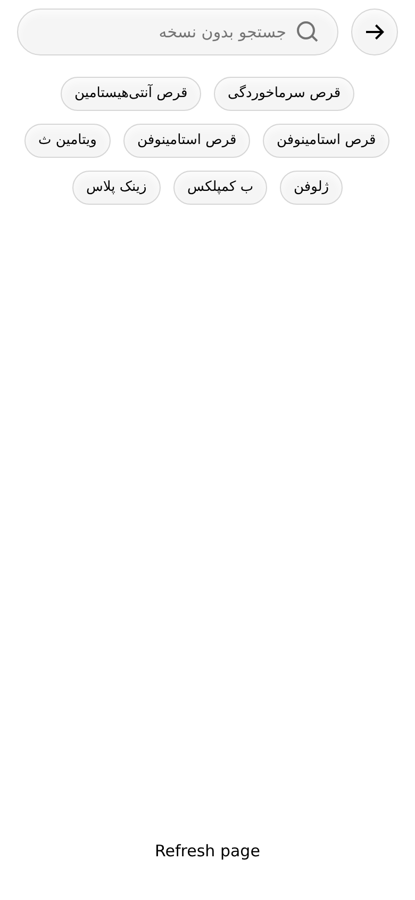

# Search suggestions pop-in

A search page empty state where the suggestion chips appear with a fast,
playful, **randomized spring pop-in**. Each chip starts tiny and invisible,
then springs to full size with a small bounce, in a random order and with
overlapping timing, so the effect feels organic rather than mechanically
staggered.

Built with React + [Framer Motion](https://www.framer.com/motion/), RTL-first (Persian UI).

| Mid-animation | Settled |
| :-: | :-: |
|  |  |

## Run the demo

```bash
npm install
npm run dev       # local dev server
npm run build     # type-check + production build into dist/
npm run preview   # serve the production build
```

The demo shows the page in a 390×844 frame. **Refresh page** remounts the
search page to replay the animation. Typing hides the chips, and clearing the
field brings them back with a new random pop.

## Use it in your project

Copy `src/search/` into your app. It needs `react` and `framer-motion`.

```tsx
import { SearchPage } from "./search/SearchPage";

<SearchPage onBack={() => history.back()} />
```

Or use the chips on their own:

```tsx
import { SuggestionChips } from "./search/SuggestionChips";

<SuggestionChips
  suggestions={[{ id: "vitamin-c", label: "ویتامین ث" }]}
  onSelect={(s) => setQuery(s.label)}
/>
```

If your project uses the newer `motion` package instead of `framer-motion`,
change the import in `SuggestionChips.tsx` to `motion/react`. The API is the same.

## How the animation works

- **Two states per chip.** `false` = `opacity: 0, scale(0.1)`; `true` = `opacity: 1, scale(1)`.
  Every chip is its own `motion.button`, so they animate independently.
- **Random timing.** On mount the chips are shuffled into a random order and
  spread across a ~0.22s window, plus up to 0.05s of jitter each. Neighbours
  often overlap, so several chips pop at almost the same moment. All chips
  have started within about 0.3s.
- **Spring, not easing.** Scale uses a spring (`stiffness 560, damping 20, mass 0.7`)
  for a short overshoot. Opacity uses a quick 120ms ease-out so the chip pops
  instead of flickering.
- **Stable delays.** Delays are created once in a `useState` initializer: re-renders
  keep them, and a real re-entry (unmount → mount) gets a fresh random order.
- **No layout shift.** Only `transform` and `opacity` animate, so every chip
  holds its final flex-wrap position from the first frame.
- **Reduced motion.** With `prefers-reduced-motion: reduce`, chips fade in only, with no scale and shorter delays.

### Tuning

All in `src/search/SuggestionChips.tsx`:

| Constant | Default | Effect |
| --- | --- | --- |
| `POP_SPRING.damping` | `20` | Higher = less bounce (try `24` for calmer) |
| `POP_SPRING.stiffness` | `560` | Higher = snappier |
| `START_OFFSET` | `0.06` s | Pause before the first chip |
| `SPREAD` | `0.22` s | Window the random order is spread across |
| `JITTER` | `0.05` s | Random noise per chip |

## Project structure

```
src/
  search/                 ← the reusable part
    SuggestionChips.tsx   animated chips
    SearchPage.tsx        header + empty state
    search.css            styles (tokens mirror the Figma variables)
    assets/               icons exported from Figma
  demo/                   demo page only (390×844 frame, refresh button)
.github/workflows/
  deploy.yml              builds and deploys the demo to GitHub Pages
```

## Deploy the demo to GitHub Pages

1. Push this repo to GitHub on the `main` branch.
2. In the repo, go to **Settings → Pages → Build and deployment** and set **Source** to **GitHub Actions**.
3. The workflow runs on every push to `main`; the demo URL appears in the Actions run.

## Notes

- **Font:** the design uses Digikala, which isn't publicly licensed, so the demo
  falls back to [Vazirmatn](https://github.com/rastikerdar/vazirmatn). If your app
  loads Digikala, it's picked up automatically.
- **Content:** the suggestion list comes from the Figma design, including its
  repeated "قرص استامینوفن" chip.
